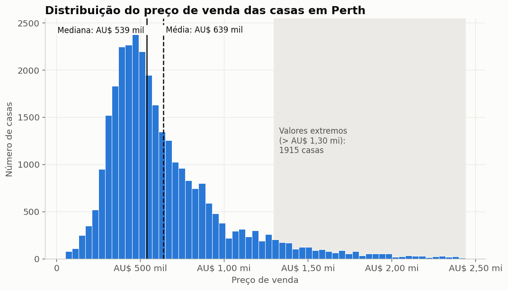
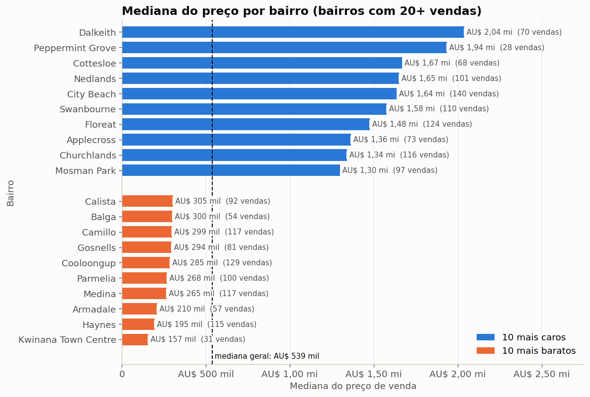
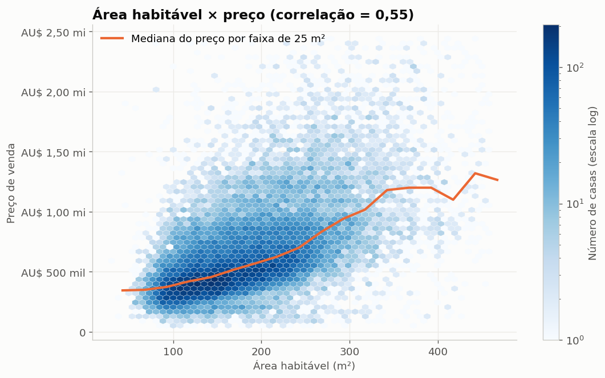
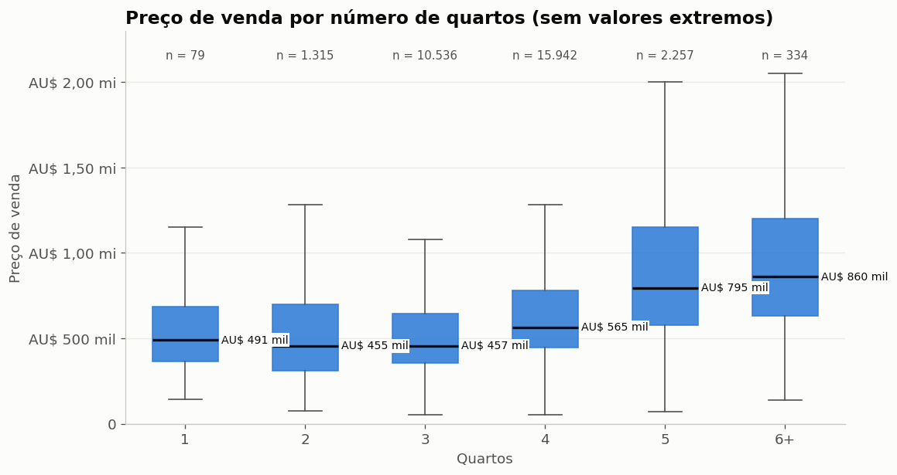
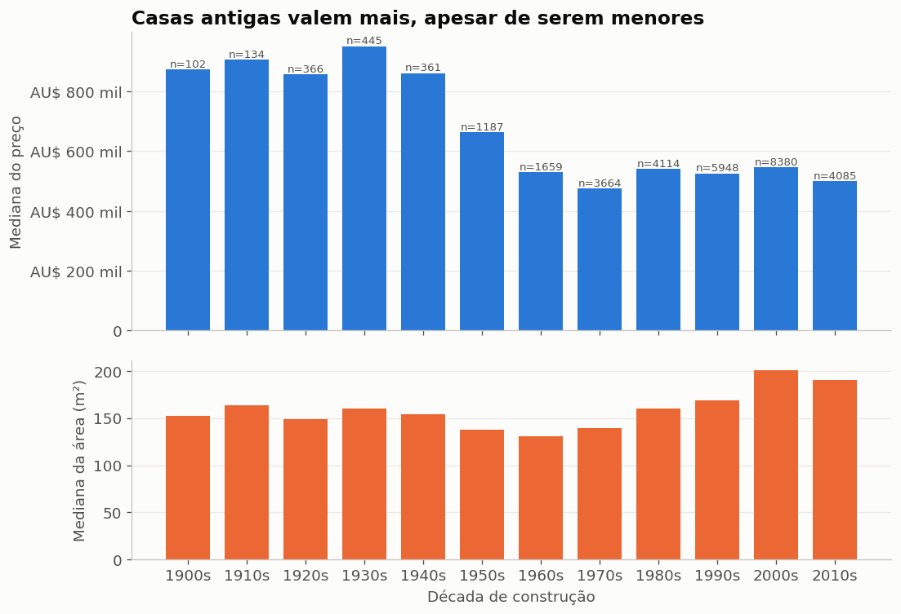
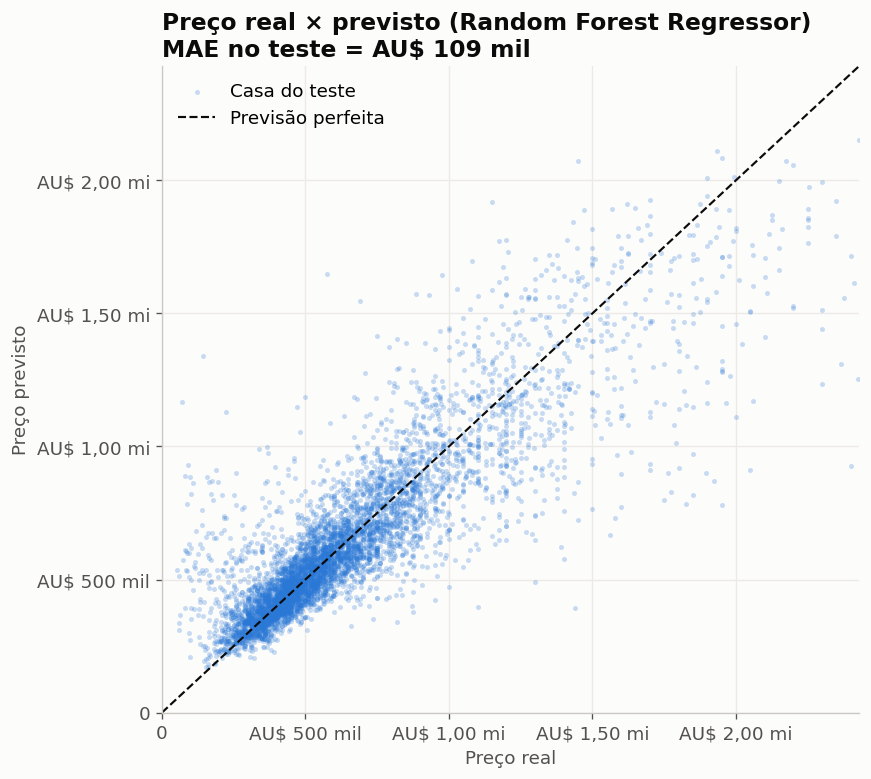

# Análise exploratória: preço das casas em Perth

Gerado automaticamente por `analise.py` a partir de `perth_house_prices_tratado.csv`
(30.463 casas, preços em dólar australiano). O tratamento está em
[`registro_tratamento.md`](registro_tratamento.md).

**Pergunta do projeto:** o que determina o preço de uma casa em Perth, usando área
habitável, quartos, ano de construção e bairro? As respostas abaixo justificam as
variáveis escolhidas para o modelo de Machine Learning.

## Estatísticas descritivas

| | area_habitavel | quartos | ano_construcao | preco |
|---|---|---|---|---|
| count | 30.463,0 | 30.463,0 | 30.463,0 | 30.463,0 |
| mean | 183,4 | 3,7 | 1.989,7 | 638.660,7 |
| std | 71,9 | 0,7 | 21,0 | 357.209,5 |
| min | 30,0 | 1,0 | 1.868,0 | 52.000,0 |
| 25% | 130,0 | 3,0 | 1.978,0 | 410.000,0 |
| 50% | 172,0 | 4,0 | 1.995,0 | 539.000,0 |
| 75% | 223,0 | 4,0 | 2.005,0 | 765.000,0 |
| max | 849,0 | 10,0 | 2.017,0 | 2.440.000,0 |

Correlação de cada variável numérica com o preço: área habitável **0,55**,
quartos **0,26**, ano de construção **-0,16**.

## Gráficos e interpretação

### 1. Distribuição do preço (histograma)

- **Concentração:** metade das casas custa entre AU$ 410 mil e AU$ 765 mil
  (1º e 3º quartis); a mediana é AU$ 539 mil.
- **Dispersão:** o desvio padrão é alto (AU$ 357 mil), mais da metade da média.
- **Valores extremos:** a cauda direita é longa (assimetria = 1,77).
  1.915 casas (6,3%) passam de AU$ 1,30 mi
  (Q3 + 1,5 × IQR), até AU$ 2,44 mi. Por isso a **média (AU$ 639 mil) fica acima
  da mediana**, e a mediana é a medida usada nas comparações. As casas caras são reais (não são
  erros), então foram mantidas.

### 2. Preço por bairro (barras)

- A mediana do bairro mais caro (Dalkeith, AU$ 2,04 mi) é
  **13 vezes** a do mais barato (Kwinana Town Centre, AU$ 157 mil).
  Nenhuma outra variável produz uma diferença desse tamanho.
- **Desequilíbrio:** a base tem 319 bairros, com 1 a
  209 vendas cada. 19 bairros têm menos
  de 20 vendas e ficaram fora do gráfico, porque a mediana deles é pouco confiável.
  O modelo também erra mais nesses bairros.

### 3. Área habitável × preço (dispersão em hexágonos)

- É a variável numérica mais ligada ao preço (correlação 0,55): a linha da
  mediana sobe de forma quase contínua com a área.
- A nuvem se abre para a direita: com a mesma área, uma casa pode custar de AU$ 300 mil a
  mais de AU$ 2 mi. A área sozinha não basta; essa diferença vem principalmente do **bairro**.
- A maior parte das casas fica entre 100 e 250 m² (hexágonos mais escuros).

### 4. Preço por número de quartos (boxplot)

- Casas de 2 e 3 quartos têm praticamente a mesma mediana (AU$ 455 mil e AU$ 457 mil).
  O preço só sobe de forma clara a partir de 4 quartos (AU$ 565 mil) e 5 quartos (AU$ 795 mil).
- Correlação baixa (0,26): quartos e área andam juntos (correlação
  0,54), então os quartos acrescentam pouca informação além da área.
- **Desequilíbrio:** 3 e 4 quartos somam 87% das casas;
  1 quarto e 6+ quartos têm poucos exemplos, e as caixas deles são menos confiáveis.

### 5. Preço e área por década de construção (barras)

- Casas construídas entre 1900 e 1949 têm mediana de AU$ 885 mil, contra
  AU$ 530 mil das construídas a partir de 2000, **mesmo sendo menores**
  (painel de baixo). Por isso a correlação do ano com o preço é negativa (-0,16).
- Não é a idade que valoriza a casa: as casas antigas ficam nos bairros centrais e
  tradicionais, e as novas nos loteamentos da periferia. O ano funciona em parte como
  um indicador da localização.

### 6. Extra: preço real × previsto pelo modelo

O alvo é numérico (regressão), então a matriz de confusão não se aplica. O gráfico
equivalente compara o preço real com o previsto no conjunto de teste: os pontos seguem a
diagonal, mas se espalham mais nas casas caras e o modelo subestima as mais caras de todas,
como mostra a tabela de erro por faixa em `MACHINE_LEARNING.md`.

## Principais achados

1. **A localização é o fator que mais pesa no preço.** A mediana muda 13 vezes
   entre bairros (Dalkeith × Kwinana Town Centre), muito mais do que entre casas pequenas e grandes.
   Isso justifica manter o bairro no modelo, mesmo com 319 categorias.
2. **O preço é assimétrico, com uma cauda de casas caras.** A média (AU$ 639 mil) fica
   AU$ 100 mil acima da mediana (AU$ 539 mil) e 12%
   das casas passam de AU$ 1 mi. Essas casas têm poucos exemplos e são onde o modelo erra mais em dinheiro.
3. **Área explica mais que quartos.** A área tem correlação 0,55 com o preço,
   contra 0,26 dos quartos; 2 e 3 quartos custam praticamente o mesmo.
4. **Casas antigas valem mais, mas por causa de onde estão.** As construídas antes de 1950 são
   menores e mesmo assim mais caras, porque ficam nos bairros mais valorizados. É um exemplo de
   correlação que não é causa.
5. **A base é desequilibrada em bairros e em número de quartos**, o que deixa as estimativas
   menos confiáveis para bairros com poucas vendas e para casas com 1 ou 6+ quartos.
